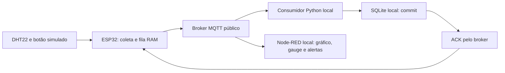

# Fase 3 — Monitoramento contínuo com IoT

Implementamos o protótipo ESP32 → MQTT → consumidor SQLite → painel Node-RED. Este guia permite reproduzir coleta, interrupção, recuperação e alertas sem depender do ambiente utilizado pelo grupo.

**Situação reavaliada em 26/10/2026:** validamos as implementações Edge, MQTT e Node-RED. Produzimos o [relatório Edge de duas páginas](CardioIA_Fase3_Relatorio_Edge.pdf) e o [relatório MQTT/dashboard de três páginas](CardioIA_Fase3_Relatorio_MQTT_Dashboard.pdf), com paginação conferida e revisão final do grupo pendente. Os dois desafios Ir Além ainda estão pendentes. A [matriz do enunciado](CHECKLIST_ENUNCIADO.md) relaciona requisitos, evidências e pendências; o [roteiro](ROTEIRO_ENTREGA.md) organiza o trabalho restante. O prazo informado é **04/11/2026, às 23h59**.

## Qual Wokwi utilizar

Reutilizamos o circuito ESP32, DHT22, botão verde e chave online/offline em duas implementações. A aparência igual é intencional; **o transporte e o comportamento do firmware são diferentes**.

| Parte | Projeto público | Código em `src/fase3/firmware/` | Resultado esperado |
|---|---|---|---|
| Parte 1 — demonstração isolada da resiliência | [Edge com saída Serial](https://wokwi.com/projects/478054573982428161) | [cardioia_edge](../../src/fase3/firmware/cardioia_edge/) | JSON `transport: serial_demo`; esvaziamento da fila pelo Serial; dispensa Python, broker e Node-RED |
| Parte 2 — sistema completo, caminho principal | [MQTT com painel](https://wokwi.com/projects/478772789361460225) | [cardioia_mqtt](../../src/fase3/firmware/cardioia_mqtt/) | JSON `transport: mqtt`; envio ao broker real, persistência e ACK; atualização do painel |

Para testar o monitoramento, utilizar **o segundo link**. Para demonstrar o envio Serial solicitado na Parte 1, utilizar o primeiro. Não é necessário executar ambos ao mesmo tempo. Reutilizamos a montagem e o núcleo da fila; os sketches de comunicação são distintos.

O DHT22 conta como **um sensor**, apesar de fornecer temperatura e umidade. Utilizamos o botão como segunda entrada para simular pulsos, alternativa prevista no enunciado. A chave controla a conectividade simulada: **esquerda = offline; direita = online**. Ela não contém senha ou credencial.

## Como reproduzir — preparação

Pré-requisitos: Git, Python **3.12**, Node.js **24** com npm, navegador e internet. A conexão MQTT utiliza TCP **1883**. Não é necessário hardware físico, conta paga, chave de API ou Grafana.

Para obter uma cópia nova, executar no PowerShell:

```powershell
git clone https://github.com/murilosalla-blip/fiap-ano02-fase03-cardioia.git
Set-Location -LiteralPath './fiap-ano02-fase03-cardioia'
python --version
node --version
npm --version
python -m venv .venv
.\.venv\Scripts\python.exe -m pip install -r config/fase3/requirements-mqtt.txt
npm ci --prefix src/fase3/node-red --ignore-scripts --no-audit --no-fund
```

Todos os comandos seguintes partem da **raiz do repositório**, não de `src/fase3/`. Se a cópia e o ambiente já existem, não repetir o clone ou a criação do ambiente. Utilizamos o executável do ambiente diretamente, sem alterar a política de execução do PowerShell.

No Linux/macOS:

```bash
git clone https://github.com/murilosalla-blip/fiap-ano02-fase03-cardioia.git
cd fiap-ano02-fase03-cardioia
python3.12 -m venv .venv
./.venv/bin/python -m pip install -r config/fase3/requirements-mqtt.txt
npm ci --prefix src/fase3/node-red --ignore-scripts --no-audit --no-fund
```

Nos demais comandos Python deste guia, substituir `.\.venv\Scripts\python.exe` por `./.venv/bin/python` no Linux/macOS.

## Parte 1 — sensores, fila offline e saída Serial

Esta demonstração pode ser avaliada no navegador, sem instalar as dependências do painel.

1. Abrir o [Wokwi da Parte 1](https://wokwi.com/projects/478054573982428161) e dar **Play**.
2. Conferir no Monitor Serial `CardioIA Edge: saida SERIAL LOCAL, sem MQTT nesta entrega` e `capacidade=2000`.
3. Mover a chave para a **esquerda**. A cada cinco segundos simulados, observar `# coleta seq=... fila=... perdas=0 resultado=armazenada`. A fila deve crescer mesmo offline. Aguardar pelo menos três coletas.
4. Pressionar e soltar o botão verde algumas vezes; clicar no DHT22 e alterar a temperatura. A leitura seguinte deve incorporar os valores, mesmo sem conexão.
5. Mover a chave para a **direita**. Conferir a saída dos JSON em ordem de `sequence`, com `transport: serial_demo`, preservando o instante relativo de coleta. A fila deve esvaziar após a escrita Serial.
6. Voltar à esquerda e repetir: a coleta deve continuar sem reiniciar o ESP32.

Simulamos a nuvem pela saída Serial, como permite a Parte 1. Essa variante não conecta ao broker. Como não utilizamos arquivo SPIFFS, removemos a amostra da fila RAM após a escrita Serial; não existe CSV local a apagar. O enunciado admite a alternativa do Monitor Serial no simulador.

### Capacidade e limites da resiliência

Definimos uma fila FIFO de **2.000 amostras**. A cinco segundos por coleta, cobrimos aproximadamente **2 h 46 min 40 s do relógio simulado** sem comunicação. Escolhemos esse limite para demonstrar acompanhamento durante interrupções, preservando memória e explicitando o limite da retenção. Não é armazenamento ilimitado nem garantia clínica.

Quando a fila enche, preservamos as amostras antigas e descartamos a nova, incrementando `dropped_total`. A sequência continua avançando para evidenciar a perda. A política prioriza o histórico já retido; uma aplicação real exigiria avaliar a prioridade de dados recentes.

A fila fica em **RAM**: parar ou reiniciar a simulação perde as pendências e inicia outra `session_id`. O banco da Parte 2 preserva apenas o que o consumidor já recebeu e gravou. Não apresentamos RAM como persistência após reinício. SPIFFS é opcional e não compõe a pontuação obrigatória no enunciado fornecido.

Validamos o estouro com capacidade reduzida para tornar o ensaio viável, depois restauramos as **2.000 amostras** do firmware entregue. Não é necessário esperar horas para verificar essa política: consultar os [testes do núcleo e cenários](tests/README.md).

## Parte 2 — MQTT e painel

### 1. Iniciar os serviços locais

No PowerShell, selecionar o Python do ambiente e iniciar painel e consumidor:

```powershell
$env:CARDIOIA_PYTHON = (Resolve-Path .\.venv\Scripts\python.exe).Path
node scripts/fase3/iniciar_dashboard.js --com-consumidor
```

No Linux/macOS:

```bash
export CARDIOIA_PYTHON="$PWD/.venv/bin/python"
node scripts/fase3/iniciar_dashboard.js --com-consumidor
```

Manter esse terminal aberto. O inicializador prepara os arquivos locais, inicia o Node-RED e **um consumidor Python**. Não executar outro consumidor no mesmo tópico durante o teste, pois ele poderia confirmar mensagens de um ensaio que pretendia omitir o ACK.

Abrir o [painel](http://127.0.0.1:1880/dashboard/monitoramento). O [editor Node-RED](http://127.0.0.1:1880/editor/) permite inspecionar o fluxo. Antes de ligar o ESP32, é normal aguardar dados. A conexão com o broker e a atualidade da telemetria têm indicadores separados.

### 2. Ligar o ESP32 correto

Abrir o [Wokwi MQTT da Parte 2](https://wokwi.com/projects/478772789361460225), dar **Play** e mover a chave para a **direita**. Manter apenas uma instância desse firmware MQTT ativa para esta demonstração.

No Serial, conferir a identificação MQTT, a conexão e os eventos de coleta/publicação. Após a primeira gravação pelo consumidor, deve aparecer `# ack_confirmado seq=... fila=0`, ou uma fila decrescente quando há pendências. O JSON deve conter `transport: mqtt`, `session_id`, `sequence`, `temperature_c`, `pulse_count`, `heart_rate_bpm`, `age_ms` e `attempt`.

O painel deve atualizar leitura, confirmação, gráfico, temperatura e umidade. `# mqtt_publicacao=tentada` sozinho **não comprova gravação**; o ACK confirma que o consumidor terminou a transação SQLite.

### 3. Testar pulsos e gráfico

Pressionar **e soltar** o botão verde ou a tecla **B**. Calculamos `BPM = pulse_count × 60000 / window_ms`: seis pulsos em 5.000 ms representam 72 BPM. Se os acionamentos atravessarem duas janelas, o valor será dividido entre elas; conferir `pulse_count` e `window_ms` no Serial.

Segurar o botão conta um único acionamento, não uma sequência automática. Sem pressionar, registramos **zero pulsos simulados**. Isso não significa parada cardíaca e não gera um alerta clínico de ausência de batimentos. O gráfico permanece em zero quando todas as amostras têm zero; isso é um registro válido.

Para conferir o alerta, realizar **mais de dez acionamentos em cada janela de cinco segundos simulados**, por duas coletas atuais consecutivas. O painel deve registrar o limite didático ultrapassado. Depois, reduzir os acionamentos para obter até 108 BPM por duas leituras atuais e conferir o retorno. Acompanhar as coletas no Serial para identificar as janelas.

### 4. Testar temperatura e alerta

Com a simulação em execução, clicar no **DHT22**, alterar para **31 °C** e aguardar duas leituras atuais consecutivas. Conferir a mudança no JSON, na tabela, no gauge e no evento de alerta. Depois, reduzir para **28 °C** e aguardar duas leituras atuais para conferir o retorno.

Podemos testar temperatura sem apertar o botão. A umidade também pode ser alterada no DHT22 e deve aparecer no painel, mas não definimos alerta para esse campo. Medimos **temperatura ambiente simulada**, não corporal. O limite >38 °C do enunciado é um exemplo; escolhemos >30 °C para esta demonstração ambiental.

| Indicador | Entrada no alerta | Retorno |
|---|---|---|
| Pulsos simulados | >120 BPM em duas leituras atuais consecutivas | ≤108 BPM em duas leituras atuais consecutivas |
| Temperatura ambiente | >30 °C em duas leituras atuais consecutivas | ≤28 °C em duas leituras atuais consecutivas |

Contamos leituras **únicas e atuais**. Reenvios e dados antigos recuperados não confirmam alertas do presente. Os limites e a confirmação em duas janelas são escolhas do grupo, não critérios clínicos nem números obrigatórios do exercício.

### 5. Testar interrupção e recuperação

Mover a chave para a **esquerda** e aguardar pelo menos três novas coletas. O Serial deve continuar mostrando `armazenada`, com fila crescente e perdas zero enquanto houver espaço. O painel deve sinalizar a interrupção ou falta de atualização e preservar o histórico.

Voltar à **direita**. Aguardar reconexão ao Wi-Fi e ao broker. Conferir as sequências pendentes em ordem, os ACKs e a redução da fila até zero. Amostras com idade acima de dez segundos simulados são identificadas como `replay: true` e aparecem como recuperadas. Após a recuperação, leituras atuais voltam a alimentar indicadores e alertas.

Utilizamos `broker.hivemq.com:1883`. A raiz de tópicos `cardioia/aura/fase3/478054573982428161/v1` identifica o namespace original e **não determina qual Wokwi executar**. A Parte 2 mantém essa raiz por compatibilidade. Os tópicos do dispositivo `cardioia-esp32-01` terminam em `/telemetry`, `/ack` e `/status`.



O broker fica na internet; consumidor, banco e Node-RED ficam na máquina de avaliação. Publicamos somente dados fictícios. Não utilizamos o broker público como serviço médico ou armazenamento permanente.

### 6. Conferir os registros e encerrar

Em outro terminal PowerShell, na raiz, consultar os eventos:

```powershell
Get-Content .tools/runtime/fase3/node-red/consumidor.log -Tail 20
```

São esperados `broker_connected`, `subscribed`, `stored` e `ack_queued`. Repetições válidas aparecem como `duplicate`, sem nova linha para a mesma identidade no banco. Para consultar medições por sessão:

```powershell
.\.venv\Scripts\python.exe -c "import sqlite3; c=sqlite3.connect('.tools/runtime/fase3/telemetria.sqlite3'); print(c.execute('SELECT session_id, COUNT(*), MAX(sequence) FROM samples GROUP BY session_id').fetchall()); c.close()"
```

Executar a consulta após o consumidor iniciar e receber dados. A chave é `(device_id, session_id, sequence)`; novas sessões podem reiniciar a sequência sem sobrescrever sessões anteriores. O total varia conforme o teste.

Parar o Wokwi e pressionar **Ctrl+C** no terminal do painel para encerrar também os processos filhos. O banco `.tools/runtime/fase3/telemetria.sqlite3` e os eventos `.tools/runtime/fase3/eventos_mqtt.jsonl` permanecem locais. Reiniciar apenas o painel limpa seu histórico em memória, mas não apaga o banco. Não é necessário excluir bancos para repetir o teste.

## Teste adicional — reenvio e deduplicação

Parar primeiro o painel com consumidor integrado. Depois, iniciar **somente o painel** em um terminal:

```powershell
node scripts/fase3/iniciar_dashboard.js
```

Em outro terminal, iniciar o único consumidor do ensaio:

```powershell
.\.venv\Scripts\python.exe -u src/fase3/python/consumidor_mqtt.py --reter-primeiro-ack
```

Reiniciar a simulação MQTT para iniciar uma sessão identificável, colocar a chave online e aguardar a primeira amostra. O consumidor deve registrar `stored` e `ack_withheld`. Após aproximadamente três segundos **simulados**, o ESP32 deve reenviar a mesma identidade com `attempt` maior; o consumidor deve registrar `duplicate` e `ack_queued`, e o ESP32 deve confirmar o ACK. O banco mantém uma única linha para aquela identidade.

Encerrar ambos os terminais com Ctrl+C antes de voltar à inicialização integrada. Não manter dois consumidores concorrentes durante a retenção do ACK.

## Tempos, estados e diagnóstico de falhas

| Situação | Como interpretar e verificar |
|---|---|
| Leituras demoram mais de cinco segundos reais | O intervalo é do ESP32 simulado. Manter o Wokwi visível; em segundo plano, pode desacelerar. |
| Broker conectado, valores cinza | Não chegou leitura atual nos últimos 15 segundos reais. Conferir se `sequence` avança no Serial. Conexão e atualidade são condições diferentes. |
| Serial mostra coleta, painel não recebe | Conferir projeto **MQTT**, `transport: mqtt`, chave à direita e conexão ao broker. A variante Serial não alimenta o painel. |
| Publicações se repetem e a fila cresce | Conferir consumidor ativo, Python escolhido e `consumidor.log`. Sem ACK após commit, preservamos e reenviamos a amostra. |
| `ModuleNotFoundError` | Instalar `config/fase3/requirements-mqtt.txt` no mesmo `.venv` e selecionar `CARDIOIA_PYTHON` antes da inicialização integrada. |
| Porta 1880 ocupada | Encerrar a instância anterior com Ctrl+C. Não iniciar o mesmo painel duas vezes. |
| `mqtt_falha` persiste | Conferir internet, chave online, acesso TCP 1883 e disponibilidade do broker. Uma falha temporária pode ser recuperada; reiniciar o Wokwi perde a fila RAM. |
| Gauge não muda | Conferir `temperature_c` e avanço da sequência no JSON. Alterar o DHT22 durante a execução; não editar código para simular uma leitura recebida. |
| Alerta não entra ou não retorna | Conferir duas janelas atuais consecutivas e os limites de entrada/saída. Recuperação de dados antigos não ativa nem resolve alerta atual. |

Uma leitura atual exige `age_ms <= 10000`, `backlog_samples == 1`, recebimento local nos últimos 15 segundos e conexão disponível. Não substituímos ausência de atualização por zero. DHT inválido produz `null`, não zero grau. O keepalive MQTT é de 300 segundos por causa da diferença entre relógio simulado e real; uma falha silenciosa pode demorar a gerar Last Will. A validade dos dados continua independente desse prazo.

## Código, export e evidências

| Artefato | Onde conferir |
|---|---|
| ESP32 Parte 1 e Parte 2 | [Firmware Serial](../../src/fase3/firmware/cardioia_edge/), [firmware MQTT](../../src/fase3/firmware/cardioia_mqtt/) |
| Formato da telemetria | [Contratos](contratos/README.md), `config/fase3/contratos/` |
| Consumidor e SQLite | [Protocolo MQTT](mqtt/README.md), `src/fase3/python/` |
| Export Node-RED | [flows.json](../../src/fase3/node-red/flows.json), [regras e configuração](node-red/README.md) |
| Capturas do painel | [Evidências visuais](../../assets/fase3/evidencias/) |
| Testes automatizados | [Instruções](tests/README.md), `src/fase3/tests/` |
| Resiliência e fila cheia | [Resultados Edge](../other/fase3/evidencias/2026-10-24/RESULTADOS.md) |
| Reenvio e recuperação MQTT | [Resultados MQTT](../other/fase3/evidencias/2026-10-24/mqtt/RESULTADOS.md) |
| Painel e alertas | [Resultados Node-RED](../other/fase3/evidencias/2026-10-24/dashboard/RESULTADOS.md), [validação guiada](../other/fase3/evidencias/2026-10-24/dashboard/validacao_guiada/RESULTADOS.md), [estabilidade](../other/fase3/evidencias/2026-10-24/dashboard/estabilidade/RESULTADOS.md) |

O inicializador carrega o export e suas dependências. Para importar em outra instância, instalar FlowFuse Dashboard e disponibilizar `monitor.js` por `config/fase3/node-red/settings.js`. O JSON sozinho não inclui essa configuração. Consultar o [guia Node-RED](node-red/README.md).

Os registros Markdown e prints comprovam testes, mas **não substituem os relatórios com mínimos de páginas**. Produzimos os relatórios Edge (duas páginas) e MQTT/dashboard (três páginas), disponíveis no início deste guia. Ainda precisamos implementar o Ir Além 1 com cliente REST, regras, e-mail simulado e relatório de 1–2 páginas; e implementar o Ir Além 2 com comparação tradicional × LIF/FHN, notebook, relatório de duas páginas e vídeo não listado de até quatro minutos no README raiz. O endpoint de consulta do painel não satisfaz esses desafios.
