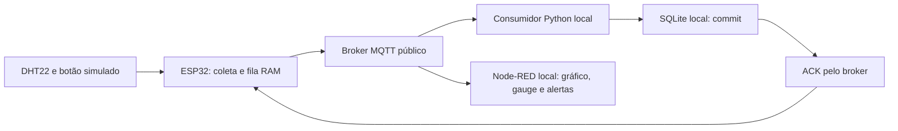

# Fase 3 — Monitoramento contínuo com IoT

Implementamos o protótipo ESP32 → MQTT → consumidor SQLite → painel Node-RED. Este guia permite reproduzir coleta, interrupção, recuperação e alertas sem depender do ambiente utilizado pelo grupo.

**Situação reavaliada em 28/10/2026:** validamos as implementações Edge, MQTT e Node-RED. Produzimos o [relatório Edge de duas páginas](CardioIA_Fase3_Relatorio_Edge.pdf) e o [relatório MQTT/dashboard de quatro páginas](CardioIA_Fase3_Relatorio_MQTT_Dashboard.pdf), com paginação conferida e revisão técnica concluída em 28/10/2026. Implementamos e testamos localmente o [Ir Além 1 REST](rest/README.md); concluímos sua validação guiada e produzimos o [relatório de duas páginas](CardioIA_Fase3_Relatorio_REST_Email.pdf), com revisão técnica concluída em 28/10/2026. Implementamos e testamos o [Ir Além 2](neuromorfismo/README.md), com notebook executado e [relatório comparativo de duas páginas](CardioIA_Fase3_Relatorio_Neuromorfismo.pdf); concluímos a validação guiada, com revisão técnica concluída e vídeo pendente. A [matriz do enunciado](CHECKLIST_ENUNCIADO.md) relaciona requisitos, evidências e pendências; o [roteiro](ROTEIRO_ENTREGA.md) organiza o trabalho restante. O prazo informado é **04/11/2026, às 23h59**.

## Qual Wokwi utilizar

Reutilizamos o circuito ESP32, DHT22, botão verde e chave online/offline em duas implementações. A aparência igual é intencional; **o transporte e o comportamento do firmware são diferentes**.

| Parte | Projeto público | Código em `src/fase3/firmware/` | Resultado esperado |
|---|---|---|---|
| Parte 1 — demonstração isolada da resiliência | [Edge com saída Serial](https://wokwi.com/projects/478054573982428161) | [cardioia_edge](../../src/fase3/firmware/cardioia_edge/) | JSON `transport: serial_demo`; esvaziamento da fila pelo Serial; dispensa Python, broker e Node-RED |
| Parte 2 — sistema completo, caminho principal | [MQTT com painel](https://wokwi.com/projects/478772789361460225) | [cardioia_mqtt](../../src/fase3/firmware/cardioia_mqtt/) | JSON `transport: mqtt`; envio ao broker real, persistência e ACK; atualização do painel |

Para testar o monitoramento, utilizar **o segundo link**. Para demonstrar o envio Serial solicitado na Parte 1, utilizar o primeiro. Não é necessário executar ambos ao mesmo tempo. Reutilizamos a montagem e o núcleo da fila; os sketches de comunicação são distintos.

O DHT22 conta como **um sensor**, apesar de fornecer temperatura e umidade. Utilizamos o botão como segunda entrada para simular pulsos, alternativa prevista no enunciado. A chave controla a conectividade simulada: **esquerda = offline; direita = online**. Ela não contém senha ou credencial.

## Como reproduzir — preparação

### Passo 1 — Entender o que vamos abrir

- **Navegador:** Chrome ou outro navegador para visualizar o circuito no Wokwi e o painel.
- **PowerShell:** janela do Windows onde colamos comandos. Abrir o menu Iniciar, digitar `PowerShell` e abrir o aplicativo. Não é necessário executar como administrador.
- **Pasta raiz:** pasta que contém `README.md`, `src`, `config`, `assets` e `document`.
- **Ambiente `.venv`:** pasta criada pelo Python para guardar as dependências deste projeto.
- **Servidor:** programa que permanece aberto para responder ao navegador ou a outro programa. Quando ele está rodando, o terminal pode não voltar ao prompt; isso é esperado.
- **MQTT e broker:** MQTT é a forma de enviar mensagens do circuito; o broker é o serviço intermediário que as distribui. O projeto já configura esse serviço.
- **Consumidor e ACK:** o consumidor recebe e grava as leituras; ACK é a confirmação de que uma leitura foi gravada.
- **API REST:** serviço consultado por endereços HTTP. Neste projeto, enviamos e consultamos dados com um cliente Python.
- **JSON:** texto com campos entre chaves, usado para transportar os dados. Ver JSON no teste REST é o resultado esperado, não um erro.

**Ordem da demonstração:** preparar o computador → testar o circuito Serial → iniciar o painel → testar MQTT e sensores → testar interrupção → encerrar → testar REST e e-mail. Depois, executar a comparação do Ir Além 2 pelo guia específico; sua validação guiada foi concluída e o vídeo permanece pendente.

### Passo 2 — Instalar e conferir os programas

1. Baixar e instalar [Git para Windows](https://git-scm.com/install/windows).
2. Baixar Python **3.12** pela [página oficial para Windows](https://www.python.org/downloads/windows/). Conferir a versão: não escolher outra apenas por aparecer como mais recente. Usar instalador completo, não o pacote embutido (*embeddable*). Se o instalador oferecer adicionar Python ao PATH, marcar essa opção.
3. Baixar [Node.js](https://nodejs.org/en/download), selecionar a versão **24**, Windows e o instalador correspondente ao computador. Manter a instalação do npm incluída.
4. Fechar e abrir novamente o PowerShell depois das instalações.
5. Executar **uma linha por vez**, pressionando Enter após cada uma:

```powershell
git --version
python --version
node --version
npm.cmd --version
```

- **Esperado:** versões do Git e npm, Python `3.12.x` e Node `v24.x`.
- **Se falhar:** não continuar. Se apenas `python` falhar, testar `py -3.12 --version`. Se funcionar, usar `py -3.12` no comando de criação do ambiente do passo 4. Se nenhuma opção funcionar, revisar a instalação com a mensagem de erro.
- **Por que `npm.cmd`:** evita que o PowerShell tente executar um arquivo `.ps1` bloqueado pela política do computador.

### Passo 3 — Baixar o projeto e entrar na pasta

1. Abrir o Explorador de Arquivos e escolher uma pasta curta com permissão de escrita, por exemplo `C:\projetos`. Criar a pasta se necessário. Caminhos muito longos podem impedir a instalação de dependências no Windows.
2. No PowerShell, entrar na pasta escolhida. O exemplo abaixo pressupõe que `C:\projetos` foi criada; se escolheu outra, substituir o caminho entre aspas:

```powershell
Set-Location -LiteralPath 'C:\projetos'
```

3. Baixar o código:

```powershell
git clone https://github.com/murilosalla-blip/fiap-ano02-fase03-cardioia.git
```

4. Aguardar o download terminar e entrar na pasta criada:

```powershell
Set-Location -LiteralPath '.\fiap-ano02-fase03-cardioia'
```

5. Conferir a localização:

```powershell
Get-Location
Test-Path .\README.md
Test-Path .\src
```

- **Esperado:** caminho terminando na pasta do projeto e dois resultados `True`.
- **Se já baixou o projeto:** não repetir o clone. Abrir sua pasta no Explorador, copiar o caminho da barra de endereços e executar `Set-Location -LiteralPath 'caminho copiado'`, substituindo o texto entre aspas. Depois fazer a conferência acima.
- **Para cada terminal novo:** repetir a entrada na pasta do projeto. O segundo PowerShell não herda automaticamente a pasta do primeiro.
- **Se o clone disser que a pasta já existe:** usar a cópia existente ou escolher uma pasta nova; não apagar arquivos para forçar o download.

### Passo 4 — Criar o ambiente Python

1. Conferir se o executável já existe:

```powershell
Test-Path .\.venv\Scripts\python.exe
```

2. Se o resultado for `False`, criar o ambiente e aguardar o retorno do prompt:

```powershell
python -m venv .venv
```

3. Conferir o ambiente, mesmo se ele já existia:

```powershell
.\.venv\Scripts\python.exe --version
```

- **Esperado:** `Python 3.12.x`. A criação do ambiente pode terminar sem imprimir mensagem.
- **Se falhar:** conferir a pasta do passo 3 e a instalação do passo 2. Se o Python global foi identificado por `py -3.12`, criar com `py -3.12 -m venv .venv`.
- **Não é necessário ativar o ambiente:** os comandos já apontam para o executável correto.

### Passo 5 — Instalar o que o projeto utiliza

1. Instalar as bibliotecas Python:

```powershell
.\.venv\Scripts\python.exe -m pip install -r config/fase3/requirements-mqtt.txt
```

2. Somente após terminar sem erro, instalar o painel:

```powershell
npm.cmd ci --prefix src/fase3/node-red --ignore-scripts --no-audit --no-fund
```

- **Esperado:** instalação concluída e retorno ao prompt. `Requirement already satisfied` significa que a biblioteca já está instalada. Aviso de atualização do pip não exige atualização para seguir.
- **Se falhar:** não iniciar os serviços. Guardar a mensagem completa e conferir a seção de diagnóstico ao final. Não instalar em outro Python para contornar o erro.
- **Para testar apenas REST:** a instalação Python é suficiente; Node-RED não é necessário.
- **Para testar apenas a Parte 1 Serial:** basta navegador e internet; pode ir diretamente à próxima seção.

### Passo 6 — Usar os comandos com segurança de execução

- Copiar somente o conteúdo dos blocos; não copiar `PS C:\...>` nem as marcas de formatação.
- Executar um comando por vez. Se surgir erro, parar nesse passo e corrigir antes do próximo.
- Usar os comandos no PowerShell. O código do Wokwi e a caixa do Monitor Serial têm outra finalidade.
- Quando um servidor estiver rodando, deixar o terminal aberto; usar outro para consultas.
- Para pedir ajuda a uma IA, enviar: número do passo, comando executado, saída completa e resultado de `Get-Location`. Não pedir para pular o erro ou marcar o teste como aprovado.

### Outros sistemas operacionais

O passo a passo guiado acima foi conferido no Windows. No Linux/macOS, instalar Git, Python 3.12 e Node.js 24 para o sistema; usar `cd` em lugar de `Set-Location`, criar o ambiente com `python3.12 -m venv .venv`, usar `./.venv/bin/python` em lugar de `.\.venv\Scripts\python.exe` e `npm` em lugar de `npm.cmd`. Para selecionar Python no inicializador, usar `export CARDIOIA_PYTHON="$PWD/.venv/bin/python"`. Os comandos específicos do Explorador e `Get-Content` são do Windows. Não afirmamos validação desta revisão nesses outros sistemas.

## Etapa 1 — Ver o circuito funcionar sem o painel

Esta demonstração pode ser avaliada no navegador, sem instalar as dependências do painel.

1. Abrir o [Wokwi da Parte 1](https://wokwi.com/projects/478054573982428161) e dar **Play**.
2. Conferir no Monitor Serial `CardioIA Edge: saida SERIAL LOCAL, sem MQTT nesta entrega` e `capacidade=2000`.
3. Mover a chave para a **esquerda**. A cada cinco segundos simulados, observar `# coleta seq=... fila=... perdas=0 resultado=armazenada`. A fila deve crescer mesmo offline. Aguardar pelo menos três coletas.
4. Pressionar e soltar o botão verde algumas vezes; clicar no DHT22 e alterar a temperatura. A leitura seguinte deve incorporar os valores, mesmo sem conexão; conferir os campos do JSON quando recuperar as pendências no passo 5.
5. Mover a chave para a **direita**. Conferir a saída dos JSON em ordem de `sequence`, com `transport: serial_demo`, preservando o instante relativo de coleta. A fila deve esvaziar após a escrita Serial.
6. Voltar à esquerda e repetir: a coleta deve continuar sem reiniciar o ESP32.
7. Clicar em **Stop** para encerrar esta simulação antes de abrir o projeto MQTT.

**Conferência antes de avançar:** observamos fila crescendo à esquerda e JSONs em ordem à direita. Se não aparecerem mensagens, conferir se o Play está ativo e se a área do Monitor Serial está aberta. Não confundir esse monitor com o editor de código.

Simulamos a nuvem pela saída Serial, como permite a Parte 1. Essa variante não conecta ao broker. Como não utilizamos arquivo SPIFFS, removemos a amostra da fila RAM após a escrita Serial; não existe CSV local a apagar. O enunciado admite a alternativa do Monitor Serial no simulador.

### Capacidade e limites da resiliência

Definimos uma fila FIFO de **2.000 amostras**. A cinco segundos por coleta, cobrimos aproximadamente **2 h 46 min 40 s do relógio simulado** sem comunicação. Escolhemos esse limite para demonstrar acompanhamento durante interrupções, preservando memória e explicitando o limite da retenção. Não é armazenamento ilimitado nem garantia clínica.

Quando a fila enche, preservamos as amostras antigas e descartamos a nova, incrementando `dropped_total`. A sequência continua avançando para evidenciar a perda. A política prioriza o histórico já retido; uma aplicação real exigiria avaliar a prioridade de dados recentes.

A fila fica em **RAM**: parar ou reiniciar a simulação perde as pendências e inicia outra `session_id`. O banco da Parte 2 preserva apenas o que o consumidor já recebeu e gravou. Não apresentamos RAM como persistência após reinício. SPIFFS é opcional e não compõe a pontuação obrigatória no enunciado fornecido.

Validamos o estouro com capacidade reduzida para tornar o ensaio viável, depois restauramos as **2.000 amostras** do firmware entregue. Não é necessário esperar horas para verificar essa política: consultar os [testes do núcleo e cenários](tests/README.md).

## Etapa 2 — Ver as leituras no painel MQTT

### Passo 1 — Iniciar painel e consumidor no terminal A

1. Usar o PowerShell que está na raiz e passou pela preparação. Vamos chamá-lo de **terminal A**.
2. Executar as duas linhas abaixo, uma por vez. A primeira escolhe o Python; a segunda inicia os serviços:

```powershell
$env:CARDIOIA_PYTHON = (Resolve-Path .\.venv\Scripts\python.exe).Path
node scripts/fase3/iniciar_dashboard.js --com-consumidor
```

No Linux/macOS:

```bash
export CARDIOIA_PYTHON="$PWD/.venv/bin/python"
node scripts/fase3/iniciar_dashboard.js --com-consumidor
```

Aguardar as mensagens `Server now running` e `Started flows` antes de abrir a página. A primeira linha `Painel: ...` apenas informa o endereço e não confirma que o servidor já está pronto; na primeira execução, o carregamento pode demorar. Se a página ainda recusar conexão, conferir o terminal em vez de iniciar outro servidor. Manter esse terminal aberto. O inicializador prepara os arquivos locais, inicia o Node-RED e **um consumidor Python**. Não executar outro consumidor no mesmo tópico durante o teste, pois ele poderia confirmar mensagens de um ensaio que pretendia omitir o ACK.

Abrir o [painel](http://127.0.0.1:1880/dashboard/monitoramento). O [editor Node-RED](http://127.0.0.1:1880/editor/) permite inspecionar o fluxo. Antes de ligar o ESP32, é normal aguardar dados. A conexão com o broker e a atualidade da telemetria têm indicadores separados.

### Passo 2 — Abrir o painel e ligar a simulação

1. Confirmar que o painel abriu e manter o terminal A ocupado pelo servidor.
2. Abrir o [Wokwi MQTT da Parte 2](https://wokwi.com/projects/478772789361460225), dar **Play** e mover a chave para a **direita**. Manter apenas uma instância desse firmware MQTT ativa para esta demonstração.

No Serial, conferir a identificação MQTT, a conexão e os eventos de coleta/publicação. Após a primeira gravação pelo consumidor, deve aparecer `# ack_confirmado seq=... fila=0`, ou uma fila decrescente quando há pendências. O JSON deve conter `transport: mqtt`, `session_id`, `sequence`, `temperature_c`, `pulse_count`, `heart_rate_bpm`, `age_ms` e `attempt`.

O painel deve atualizar leitura, confirmação, gráfico, temperatura e umidade. `# mqtt_publicacao=tentada` sozinho **não comprova gravação**; o ACK confirma que o consumidor terminou a transação SQLite.

### Passo 3 — Produzir pulsos e conferir o gráfico

1. Clicar na área da simulação para dar foco ao Wokwi.
2. Pressionar **e soltar** o botão verde ou a tecla **B**.
3. Acompanhar a próxima linha de coleta no Monitor Serial e a leitura correspondente no painel.

**Resultado esperado:** o gráfico recebe um ponto com o valor da janela de coleta. Calculamos `BPM = pulse_count × 60000 / window_ms`: seis pulsos em 5.000 ms representam 72 BPM. Se os acionamentos atravessarem duas janelas, o valor será dividido entre elas; conferir `pulse_count` e `window_ms` no Serial.

Segurar o botão conta um único acionamento, não uma sequência automática. Sem pressionar, registramos **zero pulsos simulados**. Isso não significa parada cardíaca e não gera um alerta clínico de ausência de batimentos. O gráfico permanece em zero quando todas as amostras têm zero; isso é um registro válido.

Para conferir o alerta, realizar **mais de dez acionamentos em cada janela de cinco segundos simulados**, por duas coletas atuais consecutivas. O painel deve registrar o limite didático ultrapassado. Depois, reduzir os acionamentos para obter até 108 BPM por duas leituras atuais e conferir o retorno. Acompanhar as coletas no Serial para identificar as janelas.

### Passo 4 — Alterar a temperatura e conferir o alerta

1. Deixar a simulação em execução.
2. Clicar no **DHT22**, o sensor de temperatura e umidade do circuito.
3. No controle do sensor, ajustar a temperatura para **31 °C**.
4. Aguardar duas leituras atuais consecutivas. Conferir `temperature_c` no Serial, a temperatura no medidor do painel e o evento de limite ultrapassado.
5. Ajustar para **28 °C** e aguardar outras duas leituras atuais.
6. Conferir o evento de retorno à faixa definida.

**Se não mudar:** verificar primeiro se a sequência no Serial continua avançando e se o valor enviado já mudou. Não editar o código para forçar o indicador.

Podemos testar temperatura sem apertar o botão. A umidade também pode ser alterada no DHT22 e deve aparecer no painel, mas não definimos alerta para esse campo. Medimos **temperatura ambiente simulada**, não corporal. O limite >38 °C do enunciado é um exemplo; escolhemos >30 °C para esta demonstração ambiental.

| Indicador | Entrada no alerta | Retorno |
|---|---|---|
| Pulsos simulados | >120 BPM em duas leituras atuais consecutivas | ≤108 BPM em duas leituras atuais consecutivas |
| Temperatura ambiente | >30 °C em duas leituras atuais consecutivas | ≤28 °C em duas leituras atuais consecutivas |

Contamos leituras **únicas e atuais**. Reenvios e dados antigos recuperados não confirmam alertas do presente. Os limites e a confirmação em duas janelas são escolhas do grupo, não critérios clínicos nem números obrigatórios do exercício.

### Passo 5 — Interromper a conexão e recuperar os dados

1. Mover a chave para a **esquerda**.
2. Aguardar pelo menos três novas coletas, contadas pelas linhas no Serial.

**Resultado esperado:** O Serial deve continuar mostrando `armazenada`, com fila crescente e perdas zero enquanto houver espaço. O painel deve sinalizar a interrupção ou falta de atualização e preservar o histórico.

3. Mover a chave de volta à **direita**.
4. Aguardar reconexão ao Wi-Fi e ao broker.
5. Conferir as sequências pendentes em ordem, os ACKs e a redução da fila até zero. Amostras com idade acima de dez segundos simulados são identificadas como `replay: true` e aparecem como recuperadas. Após a recuperação, leituras atuais voltam a alimentar indicadores e alertas.

Utilizamos `broker.hivemq.com:1883`. A raiz de tópicos `cardioia/aura/fase3/478054573982428161/v1` identifica o namespace original e **não determina qual Wokwi executar**. A Parte 2 mantém essa raiz por compatibilidade. Os tópicos do dispositivo `cardioia-esp32-01` terminam em `/telemetry`, `/ack` e `/status`.



O broker fica na internet; consumidor, banco e Node-RED ficam na máquina de avaliação. Publicamos somente dados fictícios. Não utilizamos o broker público como serviço médico ou armazenamento permanente.

### Passo 6 — Conferir os registros e encerrar

1. Manter o terminal A aberto.
2. Abrir um **terminal B** e entrar na mesma pasta pelo procedimento do passo 3 da preparação.
3. Consultar os eventos:

```powershell
Get-Content .tools/runtime/fase3/node-red/consumidor.log -Tail 20
```

São esperados `broker_connected`, `subscribed`, `stored` e `ack_queued`. Repetições válidas aparecem como `duplicate`, sem nova linha para a mesma identidade no banco. Para consultar medições por sessão:

```powershell
.\.venv\Scripts\python.exe -c "import sqlite3; c=sqlite3.connect('.tools/runtime/fase3/telemetria.sqlite3'); print(c.execute('SELECT session_id, COUNT(*), MAX(sequence) FROM samples GROUP BY session_id').fetchall()); c.close()"
```

Executar a consulta após o consumidor iniciar e receber dados. A chave é `(device_id, session_id, sequence)`; novas sessões podem reiniciar a sequência sem sobrescrever sessões anteriores. O total varia conforme o teste.

4. Ao terminar a conferência, clicar em **Stop** no Wokwi.
5. Pressionar **Ctrl+C** no terminal A do painel para encerrar também os processos filhos. O banco `.tools/runtime/fase3/telemetria.sqlite3` e os eventos `.tools/runtime/fase3/eventos_mqtt.jsonl` permanecem locais. Reiniciar apenas o painel limpa seu histórico em memória, mas não apaga o banco. Não é necessário excluir bancos para repetir o teste.

## Etapa 3 — Executar REST e visualizar os e-mails simulados

1. Encerrar a etapa MQTT com o procedimento acima.
2. Seguir o [passo a passo completo do Ir Além 1](rest/README.md), começando no passo 1. O ambiente Python preparado aqui pode ser reutilizado.
3. Iniciar a API no terminal A, executar o cliente no terminal B e conferir cinco leituras.
4. Abrir os dois arquivos de e-mail gerados e conferir os motivos dos alertas.
5. Reiniciar o serviço e consultar novamente para confirmar que os dados permanecem salvos.
6. Encerrar com Ctrl+C. A API mostra texto JSON; o painel gráfico pertence à etapa MQTT.

**Resultado esperado:** cinco leituras únicas por demonstração, dois e-mails locais, reenvio sem duplicação e consulta após reinício. Não há envio de e-mail real.

## Etapa 4 — Comparar os modelos do Ir Além 2

1. Seguir o [guia de séries temporais e LIF](neuromorfismo/README.md), começando no passo 1.
2. Instalar `config/fase3/requirements-neuromorfismo.txt` no Python do ambiente.
3. Executar a comparação e abrir os três gráficos na pasta local indicada.
4. Executar todas as células do notebook pelo comando `--notebook` e abrir o HTML.
5. Conferir os nove testes, as mesmas 48 sessões de teste e a análise crítica.
6. Revisar o [relatório comparativo](CardioIA_Fase3_Relatorio_Neuromorfismo.pdf) e preparar a gravação pelo [roteiro de vídeo](neuromorfismo/ROTEIRO_VIDEO.md).

**Resultado da referência:** tradicional com 44/48 acertos e LIF com 35/48, sem usar o teste para selecionar parâmetros. Os sinais são sintéticos e a rede LIF tem leitura logística treinada. Esta trilha não depende de Wokwi ou servidores. Gravação, publicação e link do vídeo ainda não estão concluídos.

## Etapa 5 — Conferir o que foi concluído

- [ ] Visualizamos coleta offline e recuperação Serial no Wokwi da Parte 1.
- [ ] Visualizamos leituras e confirmações no painel com o Wokwi MQTT.
- [ ] Conferimos gráfico de pulsos, mudança de temperatura e entrada/retorno dos alertas.
- [ ] Conferimos crescimento e esvaziamento da fila durante interrupção/reconexão.
- [ ] Consultamos as leituras REST e abrimos os dois e-mails locais.
- [ ] Reiniciamos a API e encontramos as mesmas leituras.
- [ ] Encerramos os serviços sem apagar bancos ou evidências.
- [ ] Executamos a comparação tradicional/LIF, abrimos o notebook executado e conferimos testes e limites.

Esta lista é para quem reproduz marcar durante seu próprio teste. O **Ir Além 2 possui implementação, notebook e relatório**, com reprodução detalhada no guia; concluímos a validação guiada e ainda precisamos produzir o vídeo. Os [relatórios](../../document/README.md) e as evidências complementam a avaliação, sem substituir a execução acima.

## Teste adicional — reenvio e deduplicação

Parar primeiro o painel com consumidor integrado. Depois, iniciar **somente o painel** em um terminal:

```powershell
node scripts/fase3/iniciar_dashboard.js
```

Em outro terminal, iniciar o único consumidor do ensaio:

```powershell
.\.venv\Scripts\python.exe -u src/fase3/python/consumidor_mqtt.py --reter-primeiro-ack
```

Reiniciar a simulação MQTT para iniciar uma sessão identificável, colocar a chave online e aguardar a primeira amostra. O consumidor deve registrar `stored` e `ack_withheld`. Após aproximadamente três segundos **simulados**, o ESP32 deve reenviar a mesma identidade com `attempt` maior; o consumidor deve registrar `duplicate` e `ack_queued`, e o ESP32 deve confirmar o ACK. O banco mantém uma única linha para aquela identidade.

Encerrar ambos os terminais com Ctrl+C antes de voltar à inicialização integrada. Não manter dois consumidores concorrentes durante a retenção do ACK.

## Tempos, estados e diagnóstico de falhas

| Situação | Como interpretar e verificar |
|---|---|
| Leituras demoram mais de cinco segundos reais | O intervalo é do ESP32 simulado. Manter o Wokwi visível; em segundo plano, pode desacelerar. |
| Broker conectado, valores cinza | Não chegou leitura atual nos últimos 15 segundos reais. Conferir se `sequence` avança no Serial. Conexão e atualidade são condições diferentes. |
| Serial mostra coleta, painel não recebe | Conferir projeto **MQTT**, `transport: mqtt`, chave à direita e conexão ao broker. A variante Serial não alimenta o painel. |
| Publicações se repetem e a fila cresce | Conferir consumidor ativo, Python escolhido e `consumidor.log`. Sem ACK após commit, preservamos e reenviamos a amostra. |
| `ModuleNotFoundError` | Instalar `config/fase3/requirements-mqtt.txt` no mesmo `.venv` e selecionar `CARDIOIA_PYTHON` antes da inicialização integrada. |
| Porta 1880 ocupada | Encerrar a instância anterior com Ctrl+C. Não iniciar o mesmo painel duas vezes. |
| `mqtt_falha` persiste | Conferir internet, chave online, acesso TCP 1883 e disponibilidade do broker. Uma falha temporária pode ser recuperada; reiniciar o Wokwi perde a fila RAM. |
| Gauge não muda | Conferir `temperature_c` e avanço da sequência no JSON. Alterar o DHT22 durante a execução; não editar código para simular uma leitura recebida. |
| Alerta não entra ou não retorna | Conferir duas janelas atuais consecutivas e os limites de entrada/saída. Recuperação de dados antigos não ativa nem resolve alerta atual. |

Uma leitura atual exige `age_ms <= 10000`, `backlog_samples == 1`, recebimento local nos últimos 15 segundos e conexão disponível. Não substituímos ausência de atualização por zero. DHT inválido produz `null`, não zero grau. O keepalive MQTT é de 300 segundos por causa da diferença entre relógio simulado e real; uma falha silenciosa pode demorar a gerar Last Will. A validade dos dados continua independente desse prazo.

## Código, export e evidências

| Artefato | Onde conferir |
|---|---|
| ESP32 Parte 1 e Parte 2 | [Firmware Serial](../../src/fase3/firmware/cardioia_edge/), [firmware MQTT](../../src/fase3/firmware/cardioia_mqtt/) |
| Formato da telemetria | [Contratos](contratos/README.md), `config/fase3/contratos/` |
| Consumidor e SQLite | [Protocolo MQTT](mqtt/README.md), `src/fase3/python/` |
| Export Node-RED | [flows.json](../../src/fase3/node-red/flows.json), [regras e configuração](node-red/README.md) |
| Capturas do painel | [Evidências visuais](../../assets/fase3/evidencias/) |
| Testes automatizados | [Instruções](tests/README.md), `src/fase3/tests/` |
| Resiliência e fila cheia | [Resultados Edge](../other/fase3/evidencias/2026-10-24/RESULTADOS.md) |
| Reenvio e recuperação MQTT | [Resultados MQTT](../other/fase3/evidencias/2026-10-24/mqtt/RESULTADOS.md) |
| Painel e alertas | [Resultados Node-RED](../other/fase3/evidencias/2026-10-24/dashboard/RESULTADOS.md), [validação guiada](../other/fase3/evidencias/2026-10-24/dashboard/validacao_guiada/RESULTADOS.md), [estabilidade](../other/fase3/evidencias/2026-10-24/dashboard/estabilidade/RESULTADOS.md) |

O inicializador carrega o export e suas dependências. Para importar em outra instância, instalar FlowFuse Dashboard e disponibilizar `monitor.js` por `config/fase3/node-red/settings.js`. O JSON sozinho não inclui essa configuração. Consultar o [guia Node-RED](node-red/README.md).

Os registros Markdown e prints comprovam testes, mas **não substituem os relatórios com mínimos de páginas**. Produzimos os relatórios Edge (duas páginas) e MQTT/dashboard (quatro páginas), disponíveis no início deste guia. Implementamos cliente REST, regras e e-mail simulado no [Ir Além 1](rest/README.md), com sete testes locais; concluímos sua validação guiada e produzimos o relatório de duas páginas, com revisão técnica concluída em 28/10/2026. Implementamos e testamos o [Ir Além 2](neuromorfismo/README.md), com comparação tradicional × LIF, notebook executado e relatório de duas páginas. Concluímos a validação guiada; faltam vídeo não listado de até quatro minutos no README raiz. O endpoint de consulta do painel não satisfaz esses desafios.
